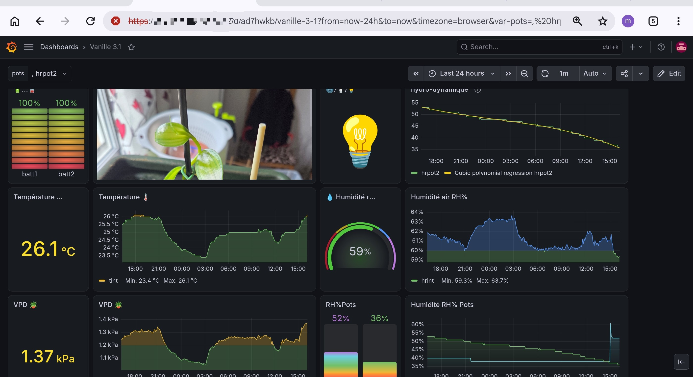

# Plants

## hardware

* Raspberry pi arm64 running 64 bits raspberry pi os
* DHT22/AM2302 on gpio - requires resistor if not embedded
* miflora compatible - bluetooth scan for mac address

## system packages / softwares

Working on Raspbberry os 13 - bookworm or 14 - Trixie

You may want to turn off raspberry pi leds in greenhouse, add to /boot/firmware/config.txt:
```
dtparam=act_led_trigger=none
dtparam=pwr_led_trigger=none
```

### minimum system package
```
sudo apt install locales-all swig vim
sudo apt install libglib2.0-dev liblgpio-dev
```

### Bluetooth permissions
Unblocking acces to bluetooth may be required
```
rfkill unblock all
```

### python

Comes with raspberry os

### postgresql database
```
sudo apt install postgresql
```
Timeseries database engine InfluxDB might be best choice for performance.

## populate
```
git clone https://github.com/mounirst/plants.git
cd plants
```

## python venv

```
python -m venv venv
source venv/bin/activate
pip install psycopg2-binary adafruit-circuitpython-dht btlewrap miflora bluepy seuptools
```

## db creation
Check file plants.sql for customization.

```
sudo -u postgres psql -f plants.sql
```
sudo systemctl daemon-reload
sudo systemctl enable plants.service
sudo systemctl start plants.service

## systemd activation
Check file config.ini for password and miflora mac address customization.

```
sudo cp plants.service /etc/systemd/system/
sudo systemctl daemon-reload
sudo systemctl enable plants.service
sudo systemctl start plants.service
```

## troubleshouting
Logger messages are logged in system journal.
```
sudo journalctl -r -u plants
```

# Camera capture
## Confirm camera operation
Camera already enabled in Bookworn and Trixie.
```
rpicam-still -o test.jpg
```
## Capture script
Set MAX_ITERATIONS to capture images and then stop. Restart is trigered by capture.service.
Set INTERVALLE seconds between each capture.
Install capture.service
```
sudo cp capture.service /etc/systemd/system/
sudo systemctl daemon-reload
sudo systemctl enable capture.service
sudo systemctl start capture.service
```
## Grafana image update
It cannot occur depending on browser configuration. If required force browser cache update.
Pictures are captured in images subdirectory with a link on last capture and a copy in /usr/share/grafana/public/img.
# Dashboard
## Grafana installation
https://grafana.com/tutorials/install-grafana-on-raspberry-pi/

It is strongly advised to setup https for grafana: https://grafana.com/docs/grafana/latest/setup-grafana/set-up-https/

Datasource creation to postgres db: https://grafana.com/docs/grafana/latest/datasources/postgres/configure/
=> consider the db already exists

In case of multiple monitoring platforms, you may want to customize login_cookie_name in grafana.ini to avoid disconnections.

## Dashboard example

Dashboard code [here](exemple-grafana.json) copy/paste this url in grafana "Import dashboard" menu


